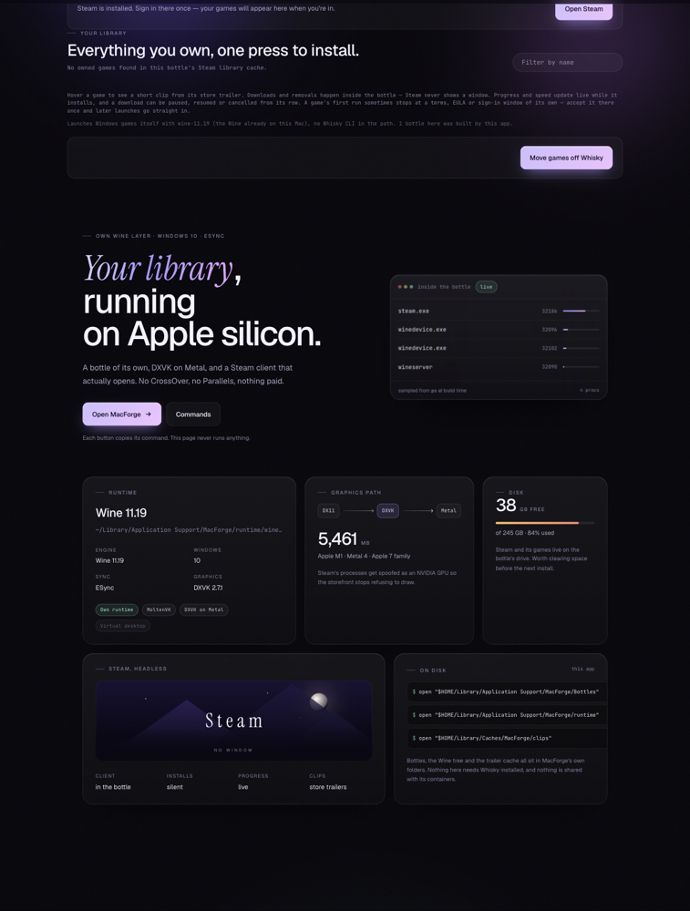
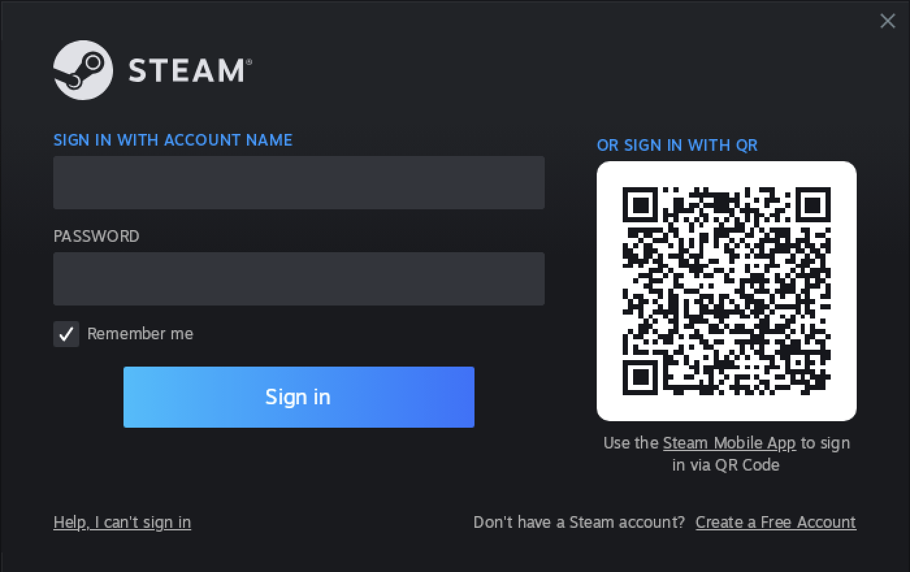
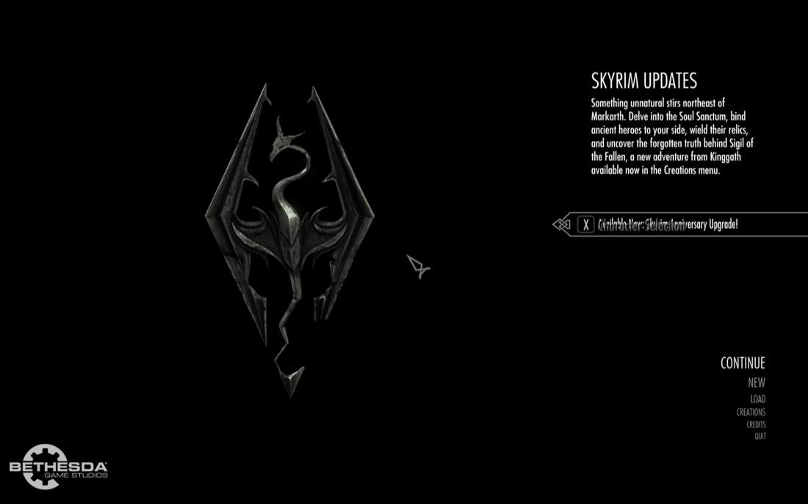

# MacForge

A macOS game launcher for Windows games on Apple silicon. It is a small AppKit
window around a WebKit view, with a local Node server and a Vite-built console
behind it. Games live in Wine bottles that MacForge manages itself: it finds the
Steam install inside a bottle, launches games on its own Wine layer, and drives
Steam's silent install/uninstall from the page — no Steam window, no CrossOver,
no Whisky install required.

> **Not the old MacForge.** This project is unrelated to the legacy MacForge
> plugin manager by MacEnhance. That tool patched macOS itself and is long
> discontinued; this is a standalone game launcher for Apple silicon and never
> modifies the system, injects into apps, or installs plugins. If you found this
> page looking for the old tweak tool, this is a different thing.



| Steam, signed in through Wine | A Windows game running |
| --- | --- |
|  |  |

The console screenshot is from a Mac that has not signed in yet, so the library
is empty — the Steam card and the **Open Steam** button are what you see at that
point. The Steam window is the real client's own sign-in page drawn by CEF inside
Wine, and the last shot is Skyrim Special Edition running in a bottle on this
machine.

## Download

The built `.dmg` is attached to the [latest release](../../releases/latest). It
is ad-hoc signed, so the first launch needs right-click → Open on a Mac that has
never run it.

Releases from a `v*` tag are built by GitHub Actions from the public source (see
[Build provenance](#build-provenance)). The `v1.0.0` asset was built from the same
committed source on a Mac before that workflow existed; the commit it was built
from is `1549a9a`.

## Requirements

- macOS 13 or newer on Apple silicon.
- No Node or Wine install: the app carries its own Node runtime and downloads
  its Wine tree on first launch.
- No existing Steam bottle: the in-app **Set up Steam** button creates one,
  installs Steam and opens it once for sign-in.
- `ffmpeg` for hover trailer clips (`brew install ffmpeg`); everything else works
  without it. Development also needs Node.js.

## Run it

```sh
npm install
npm run dev            # Vite at http://localhost:5173, API mounted on the same port
```

To run the way the app does — the built site plus the API from one loopback
server:

```sh
npm run build
PORT=5210 node server/server.mjs
```

The app itself starts that server on a random free port and loads it in the
window.

## Build the app

```sh
bash app/build.sh             # MacForge.app in the project root
bash app/build.sh --install   # also copies it to /Applications
bash app/build.sh --dmg       # also writes dist/MacForge-<version>.dmg
```

The script rebuilds `AppIcon.icns` from `app/icon.png` with `sips`, builds the
site, compiles `app/main.swift` with `swiftc`, downloads and checksums the
official Node runtime, and assembles the bundle with the server, `dist/` and
`node/` inside `Contents/Resources`. The DMG step lays the image out with Finder
(700×460 window, app and Applications icons, background image); on a runner with
no Finder session that step is skipped with a warning and the image is still
built.

The Steam webhelper shim is committed as a binary so a build needs no cross
toolchain. To rebuild it from source (`server/steam/steamwebhelper-wrapper.c`):

```sh
bash server/steam/build.sh    # uses zig, or Homebrew's mingw-w64
```

## Build provenance

`.github/workflows/release.yml` builds the app and DMG on GitHub's own macOS
runner for every `v*` tag, then attaches the result to that release:

1. `actions/checkout` at the tagged commit.
2. `npm ci` and `bash app/build.sh --dmg` — the same script documented above.
3. `gh release upload` with the runner's `GITHUB_TOKEN`, so the asset users
   download is the artifact of that run, not a file uploaded by hand.

Nothing is fetched from a private host: the only downloads are the official Node
tarball (checksum-checked against `nodejs.org`'s `SHASUMS256.txt`) and the Wine
archive described below.

## Wine runtime: exactly what gets downloaded

MacForge does not ship, patch or fork Wine. It downloads a stock macOS Wine tree
and runs it unmodified.

The installer (`server/runtime-install.mjs`, also usable as
`node scripts/fetch-runtime.mjs`) asks GitHub's release API and picks the first
of these it finds:

1. **A Gcenx crossover build** —
   [`Gcenx/macOS_Wine_builds`](https://github.com/Gcenx/macOS_Wine_builds)
   assets named `wine-crossover-*-osx64.tar.xz`. These are the CrossOver-based
   engines with MoltenVK and GStreamer, and are the first choice when published.
2. **The Whisky fork's engine bundle** —
   [`frankea/Whisky`](https://github.com/frankea/Whisky) releases, asset
   `Libraries.tar.gz`. This is the WineCX tree Whisky itself ships (Wine 11.19,
   MoltenVK, DXVK, DXMT) and is what the app installs today.
3. **The newest Gcenx devel/staging tarball** — only if neither of the above
   exists. Those builds may lack MoltenVK; the installer checks for
   `lib/libMoltenVK.dylib` afterwards and fails loudly rather than installing a
   tree that cannot render.

Before anything is unpacked, the archive is hashed and compared with the SHA-256
digest GitHub publishes for that release asset. A mismatch aborts the install;
there is no "continue anyway". It is extracted to a staging folder, must contain
`bin/wine64` and MoltenVK, and only then is it moved into
`~/Library/Application Support/MacForge/runtime/`. Nothing is written outside
that folder. To pre-seed or inspect it from a terminal:

```sh
node scripts/fetch-runtime.mjs --list   # what would be installed, and from where
node scripts/fetch-runtime.mjs          # download, verify and install
```

Two more payloads come from public releases and are pinned in the source:

- **DXVK 2.7.1** — [`doitsujin/dxvk`](https://github.com/doitsujin/dxvk) release
  tarball, verified against the digest pinned in `server/payloads.mjs`
  (`d85ce7c7…`), copied into the bottle's `system32`/`syswow64` with the native
  overrides a game needs.
- **Visual C++ 2015–2022 redistributables** — `aka.ms/vs/17/release/…` from
  Microsoft, or a copy Steam already installed in another bottle.

If a Wine tree already exists at `~/Library/Application Support/com.franke.Whisky/Libraries/Wine`,
that one is used instead of downloading anything (`/api/runtime` reports which,
and from where).

## Steam's sign-in window

Steam's own CEF login page paints black under Wine on Apple Silicon: its renderer
and GPU processes each ask for a D3D11 swapchain on a window owned by another
process, which Wine's mac driver cannot hand a Metal layer across, so the GPU
process dies and the window never draws. The app fixes that inside the bottle, at
setup, whenever Steam is reopened, and before every launch (Steam self-heals its
own files):

- `steamwebhelper.exe` is moved aside as `steamwebhelper_real.exe` and replaced by
  a small shim ([source](server/steam/steamwebhelper-wrapper.c)) that starts the
  real helper with `--disable-gpu --single-process`, i.e. CPU rasterisation with
  no cross-process swapchain. It is padded to the size of the real helper so
  Steam's size check is satisfied.
- `steam.cfg` carries `BootStrapperInhibitAll=enable` while Steam is signed out,
  so the client cannot copy its own helper back over the shim.
- The helper gets Wine's **builtin** `dxgi`, `d3d11`, `d3d10core` and `d3d9`
  through `HKCU\Software\Wine\AppDefaults\…`, because single-process CEF loads
  DXGI in the browser process, where the bottle's DXVK `dxgi.dll` faults.

The shim needs a warm CEF cache to work: `htmlcache` under
`drive_c/users/<user>/AppData/Local/Steam` is where the client writes the login
window's assets, and a missing or near-empty one (under 12 MB; a warm one is
50–80 MB) is what makes the shim's single-process helper respawn without end. So
the app measures that folder before installing anything: if it is cold, a stock
client is opened just long enough to rebuild it, then closed, and only then are
the shim and its inhibit installed. A warm bottle skips straight to the shim, and
a signed-in or shim-disabled bottle skips the check entirely.

The shim exists only to draw the sign-in window, so it goes away with it. Steam
restarts its client after a successful logon, and that restart needs its own
helper and a working bootstrapper — so the app watches `logs/steamui_login.txt`,
and on the success line it restores the stock helper and removes the `steam.cfg`
line before the restart happens. A bottle that is already signed in is left
completely stock: the steps above only run while signed out. An earlier build
held the inhibit permanently, and signing in there closed the window for good.

If the helper ever loops instead of starting — Steam respawning a helper that
dies immediately — the app stops the bottle, puts the stock client back and
leaves that bottle stock from then on (`drive_c/MacForge/steam-shim-disabled`).
A client with no sign-in window beats one that spawns processes without end.

Games are untouched by this: prefix-wide overrides stay DXVK-native.

## Where things live

| Path | What |
| --- | --- |
| `~/Library/Application Support/MacForge/Bottles` | bottles this app created or moved here |
| `~/Library/Application Support/MacForge/runtime` | the Wine tree it launches with |
| `~/Library/Application Support/MacForge/payloads` | adopted or downloaded DXVK/redist payloads |
| `~/Library/Application Support/MacForge/crashes` | crash reports for unexpected game exits (newest 25 kept) |
| `~/Library/Caches/MacForge/clips` | cached store-trailer clips for hover previews |
| `~/Library/Caches/MacForge/appinfo.json` | Steam app-name cache |

Bottles made by Whisky are still read from its containers. The console offers to
move them into MacForge's own folder with a same-volume rename (not a copy),
verifies that every installed game is still readable, and rolls back if not.

## How it works

- **Detection** reads `appmanifest_<appid>.acf` for installed Steam games and
  `shortcuts.vdf` for non-Steam entries, skipping tools such as the Common
  Redistributables. It also reads Steam's library-art cache, which is how the
  owned-library list can be shown before a game is installed.
- **Launching** goes through the runtime's own `wine64` and `wine64 start /unix`.
  Steam launches wait for the client to actually be ready (up to 300 seconds)
  before asking it to start a game. DLL overrides live in the prefix registry,
  not in `WINEDLLOVERRIDES`.
- **Installing and removing** are Steam's own silent commands, polled for
  progress and speed, with pause/resume/cancel from the game's row. Nothing is
  typed into a Steam window.
- **Terms and first runs** are not automated: a game that opens its own EULA,
  terms or sign-in screen gets a hint that a first run may need one, and later
  launches go straight in. MacForge never accepts an agreement on your behalf.
- **Crash reports** watch a game's install folder for the length of a session and
  record an unexpected exit with recent log lines; asking a game to stop does
  not produce a report.
- **Server scope** is loopback only. Mutating requests additionally require a
  same-origin `Origin`, so another page cannot drive the app.

## Layout

```
index.html, src/        the console (home rail, owned library, bottle tools)
server/                 local HTTP server, game/runtime logic, Steam fix
server/steam/           the webhelper shim: C source, build script, binary
app/                    the native shell, icon and bundling script
.github/workflows/      the release build
scripts/fetch-runtime   installs the Wine tree MacForge runs games with
```

## API

All endpoints are under `/api/` on the local server; GET unless noted.

| Endpoint | Purpose |
| --- | --- |
| `/api/games` | installed games across every readable bottle |
| `/api/library` | the owned Steam library, with install state |
| `/api/install`, `/api/uninstall`, `/api/download`, `/api/update`, `/api/verify` (POST) | Steam operations |
| `/api/launch` (POST), `/api/status`, `/api/quit` (POST) | run and stop games |
| `/api/runtime` | which Wine is in use, and from where |
| `/api/runtime/install` (POST) | downloads the app's own Wine runtime; GET follows the job |
| `/api/runtime/check` (POST) | launches a program through the runtime, then checks the DXVK payload |
| `/api/setup/steam` (POST) | creates a bottle, installs Steam and opens it for sign-in |
| `/api/steam/open` (POST) | reopens an installed Steam for sign-in, reapplying the fix |
| `/api/bottles`, `/api/bottles/migrate` (POST) | bottles still outside MacForge's folder, and moving them |
| `/api/bottle` (POST), `/api/bottle/prepare` (POST) | create a prepared bottle, or repair one |
| `/api/payloads`, `/api/preflight` | payload state and setup problems |
| `/api/crashes`, `/api/crash` | crash reports |

Mutations need a same-origin `Origin` header, for example:

```sh
curl -X POST -H 'Origin: http://127.0.0.1:5210' \
  http://127.0.0.1:5210/api/runtime/check
```

`/api/runtime/check` reports `healthy: true` only when Wine, `wineserver`,
MoltenVK, the bottle's DXVK, a prefix round-trip **and** the complete DXVK
payload all pass.

## Static build

`npm run build` writes `dist/`. `deploy.json` and `worker/index.js` can serve
those assets as a static site, but the API and game launching only exist in the
local server — a static copy is the console without a backend.
